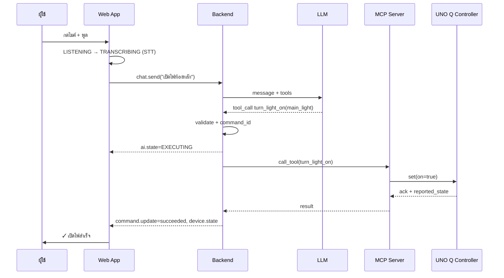
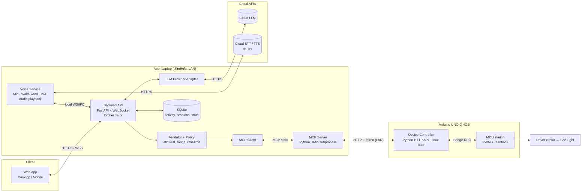

# NEXUS — AI Smart Home Assistant · UX/UI & System Blueprint (v0.3 — รอตรวจ)

> เอกสารนี้เป็นผลลัพธ์รอบ "วิเคราะห์ + ออกแบบ" ตาม [Readme.md](../Readme.md) ยังไม่มีโค้ดใด ๆ
> ทุกส่วนที่ระบุ **[สมมติฐาน]** หรือ **[ข้อเสนอ]** คือสิ่งที่ไม่ได้เห็นจากคลิปโดยตรง และต้องการการยืนยันก่อนเริ่มพัฒนา

ภาพอ้างอิงที่ตัดจากคลิป:
[clip-listening.jpg](reference/clip-listening.jpg) (t≈9.5s) · [clip-speaking.jpg](reference/clip-speaking.jpg) (t≈15.5s)

**เปลี่ยนแปลงใน v0.3:** LLM เปลี่ยนเป็น **Gemini API Free Tier** · ยืนยัน Azure Speech, คำปลุก "Nexus", ไมค์/ลำโพงของ Laptop · เพิ่มการจัดการโควตา LLM · แผน M1 แบบละเอียด (ดูข้อ 0, 9.2, 12.2, 13.1, 14)

**เปลี่ยนแปลงใน v0.2:** ชื่อระบบ NEXUS · Cloud LLM · Wake Word + บทสนทนาต่อเนื่อง + TTS ภาษาไทย · Acer Laptop เป็นเครื่องหลัก · วิเคราะห์หลอด MR16 · จัด Milestone ใหม่ให้เริ่มจากระบบเสียง (ดูข้อ 0, 7.1, 8.3–8.5, 12, 13, 14)

---

## 0. การตัดสินใจที่ยืนยันแล้ว (v0.2)

| หัวข้อ | การตัดสินใจ | ผลต่อการออกแบบ |
|---|---|---|
| ชื่อระบบ | **NEXUS** | ใช้บน AI Core, Top bar, คำปลุก และบุคลิก AI (พูดสุภาพแบบผู้ชาย "ครับ") |
| สมองหลัก | **Gemini API Free Tier** (Google AI Studio) ยังไม่เปิด Billing — โมเดลต้องรองรับ Function calling และมีโควตาฟรีเพียงพอ (ตรวจใน AI Studio ก่อนใช้) | Backend มี `LLMProvider` adapter เปลี่ยนผู้ให้บริการได้โดยไม่แก้ส่วนอื่น; ต้องรับมือโควตาหมด (HTTP 429) — ดูข้อ 9.2, 12.2 |
| Speech | **Azure AI Speech** (STT + TTS ไทย) ใช้ Free tier ก่อน — ถ้าข้อจำกัดมากเกินไปค่อยพิจารณาทางอื่น | `STTProvider` / `TTSProvider` adapter |
| ไมค์/ลำโพง | ใช้ของ **Acer Laptop** ก่อน; USB Speakerphone เป็นทางเลือกเมื่อวัดผลแล้วไม่พอ | M1 ต้องวัดคุณภาพเสียงและการปลุกผิดเพื่อใช้ตัดสินใจ |
| เครื่องหลัก | **Acer Laptop** รัน Voice Service, Backend, MCP Client, MCP Server | UNO Q ทำหน้าที่ Device Controller อย่างเดียว — ดูข้อ 12.1 |
| การสั่งด้วยเสียง | **Wake Word "Nexus"** (ยืนยันแล้ว — พูด "สวัสดี Nexus" ก็ปลุกได้) → ตอบ "ว่าไงครับ" → คุยต่อเนื่อง → จบแล้วกลับไปรอคำเรียก | เพิ่มสถานะ `WAKE_DETECTED` และ Conversation window — ดูข้อ 7.1, 8.3 |
| เสียงตอบ | **TTS ภาษาไทย** (เปิดใช้ SPEAKING state) | ต้องจัดการเสียงสะท้อน (AI ได้ยินเสียงตัวเอง) — ดูข้อ 8.4 |
| ความเข้าใจภาษา | ต้องเข้าใจทั้งคำสั่งตรงและ **คำพูดทางอ้อม** ("ไฟสว่างเกินไป", "วันนี้ร้อนจัง") | กำหนดนโยบาย "ทำเลย / ถามก่อน / แค่คุย" — ดูข้อ 8.5 |
| ฮาร์ดแวร์ | **Arduino UNO Q 4GB** (มีแล้ว) + **Philips LED MR16 GU5.3 12V 5W (Dimmable)** ไม่ใช้รีเลย์หรี่ไฟ | หลอดนี้ **ยังไม่ยืนยันว่าหรี่ด้วย PWM แบบ DC ได้** — ผู้ใช้จะตรวจรหัสรุ่นเต็มก่อน และจะไม่เลือกวงจรจนกว่าจะยืนยันความเข้ากันได้ — ดูข้อ 12.5 |
| ลำดับงาน | ยังไม่มีวันส่ง; เริ่มจาก **เสียง + Wake Word** ก่อน แล้วค่อย LLM → MCP → Arduino → อุปกรณ์จริง | Milestone ใหม่ ข้อ 13 |

---

## 1. วิเคราะห์คลิปอ้างอิง

### 1.1 ข้อเท็จจริงของไฟล์คลิป

| รายการ | ค่า |
|---|---|
| ไฟล์ | `clip.mp4` — 16.0 วินาที, 1206×2622 (แนวตั้ง), ~60fps, มีเสียงเพลงประกอบ |
| ลักษณะ | เป็น **การอัดหน้าจอโทรศัพท์ขณะดูโพสต์ Social Media** (บัญชี Aiwithtaha1) ที่ถ่ายจอ MacBook อีกที |
| สิ่งที่เห็นจริง | หน้าต่าง macOS ชื่อ "Maya AI" — **MAYA AI / HOLOGRAM MODULE 3.0** เป็น Desktop UI ขนาดประมาณครึ่งจอ |
| คุณภาพ | ถูกบีบอัดหลายชั้น + มือ/แว่นบังจอช่วง 0–2s และ 10–12s ตัวอักษรเล็กอ่านได้บางส่วน |

ข้อจำกัด: เห็นเฉพาะ **หน้าจอเดียว ขนาด Desktop** ไม่เห็น Mobile, Navigation, Settings, Error State หรือหน้าอื่นเลย

### 1.2 โครงสร้าง Layout ที่เห็น

```
┌──────────────────────────────────────────────────────────────────────────┐
│ (M) MAYA AI                                    [● ONLINE][15:24:33][60 FPS]│
│     HOLOGRAM MODULE 3.0                                                    │
├───────────────┬──────────────────────────────────┬────────────────────────┤
│ SYSTEM  LISTEN│              M A Y A             │ GLOBAL MONITOR         │
│ (CPU)(RAM)(BAT│     CORE STATUS: LISTENING       │   [ลูกโลก Hologram]     │
├───────────────┤               ▼                  │                        │
│ CORE HOLOGRAM │      .·'''''''''''''''·.         ├────────────────────────┤
│ [Arc reactor  │    :  ┌──────────────┐  :        │ CONVERSATION CORE      │
│  หมุน 3D]      │    :  │ Energy Core  │  :        │ │MAYA  Hello, I am...  │
├───────────────┤    :  └──────────────┘  :        │        YOU turn on ... │ │
│ SYSTEM VESSEL │     '·.............. ·'         │ │MAYA  Object detect..│
│ [Wireframe    │                                  │ (System status)(What..)│
│  ยาน 3D หมุน]  │      |||||||||||||||||| ← wave    │ [Ask Maya...      ][>] │
└───────────────┴──────────────────────────────────┴────────────────────────┘
   ~25%                    ~45%                          ~28%   (สัดส่วนโดยประมาณ)
```

### 1.3 องค์ประกอบที่สังเกตได้

| หมวด | สิ่งที่เห็น |
|---|---|
| **พื้นหลัง** | ดำอมน้ำเงินเข้มมาก (≈ `#04070D`) มีจุดดาวเล็ก ๆ กระจายเบา ๆ (Starfield) |
| **สีหลัก** | Cyan/Electric Blue (≈ `#2EC5FF` → `#2F6BFF`) ใช้กับวงแหวน, Energy Core, Hologram |
| **สีรอง** | Teal/Aqua (≈ `#5EEAD4`) ใช้กับ Label สถานะ (LISTENING/SPEAKING) และ Waveform ตอนพูด; ขาว 85–90% สำหรับข้อความ |
| **Glow** | ใช้หนักเฉพาะ Energy Core และหัวข้อ "MAYA" — Panel อื่นมี Glow น้อยมาก (ทำให้ยังอ่านง่าย) |
| **กรอบ Panel** | มุมโค้งเล็ก, เส้นขอบบาง ~1px โปร่ง, มี **Corner Bracket** (เส้นรูปตัว L) ที่มุมซ้ายบนและขวาล่าง — เป็นลายเซ็น HUD ที่ชัดที่สุด |
| **Typography** | หัวข้อเป็นตัวพิมพ์ใหญ่ ฟอนต์ Geometric กว้าง (คล้าย Orbitron/Michroma) Letter-spacing กว้างมาก; ข้อความแชทเป็น Sans ปกติ |
| **Status Chips** | Pill มุมมน ขอบบาง: `● ONLINE`, นาฬิกา HH:MM:SS (เดินจริง), `60 FPS` |
| **Gauges** | วงแหวนเปอร์เซ็นต์ 3 อัน CPU / RAM / BATTERY — ตัวเลขเปลี่ยนระหว่างคลิป (CPU 18→34→43→35%) |
| **AI Core** | (1) วง Tick marks ด้านนอก (2) เส้นวงกลมบาง + Arc segment ที่หมุน (3) สามเหลี่ยมชี้ตำแหน่งด้านบน (4) Energy Core ตรงกลาง |
| **Waveform** | แถบแท่งแนวตั้งใต้ Core; ตอน SPEAKING สี Teal สูงชัด, ตอน LISTENING สีขาวเทา แอมพลิจูดต่ำกว่า |
| **Conversation** | Bubble ฝั่ง MAYA ชิดซ้ายมีเส้น bracket ซ้าย, ฝั่ง YOU ชิดขวามี bracket ขวา, มี Label ผู้พูดตัวเล็กเหนือข้อความ, Scrollbar บาง, Quick-reply chips 3 อัน, ช่องพิมพ์ "Ask Maya..." + ปุ่มส่งสี่เหลี่ยมสีน้ำเงิน |
| **Hologram Panels** | CORE HOLOGRAM (วัตถุคล้าย Arc reactor หมุนแกน Y), SYSTEM VESSEL (Wireframe ยานหมุน), GLOBAL MONITOR (แผนที่โลกในวงแหวน) — **เป็นของตกแต่ง ไม่มีข้อมูล** |

### 1.4 แอนิเมชันและการเปลี่ยนสถานะที่เห็น

| สถานะในคลิป | Energy Core | Waveform | Label |
|---|---|---|---|
| **SPEAKING** | ทรงกลมพลาสมาเต็มดวง ปั่นป่วน หมุนวน สว่างมาก | Teal, สูง, เคลื่อนเร็ว | `CORE STATUS: SPEAKING` + Label มุม SYSTEM เปลี่ยนเป็น SPEAKING |
| **LISTENING** | หดเป็น **วงแหวนกลวง** ขอบสว่าง ตรงกลางมืด | ขาว/เทา, ต่ำ | `CORE STATUS: LISTENING` |

- การเปลี่ยนสถานะเกิดสอดคล้องกับบทสนทนา (AI ตอบ → SPEAKING, รอผู้ใช้ → LISTENING)
- Hologram ทั้ง 3 หมุนต่อเนื่องตลอด ไม่ขึ้นกับสถานะ
- Starfield ขยับช้า ๆ
- **ไม่เห็น** Panel entrance, การเปลี่ยนหน้า, Error, Thinking, Loading

### 1.5 สิ่งที่ "ไม่สามารถยืนยันได้" จากคลิป

- บทสนทนาพูดถึง "Object detection mode" และ "I can see glasses" แต่ **ไม่เห็นภาพกล้องบนจอ** → ไม่ถือว่าเป็นฟีเจอร์ที่ต้องทำ
- ค่า CPU/RAM/Battery เปลี่ยน แต่ไม่รู้ว่าเป็นค่าจริงหรือสุ่ม
- ไม่รู้ว่าป้อนเสียงอย่างไร (ไม่เห็นปุ่มไมค์ — สันนิษฐานว่าเป็น Always-listening หรือ Hotkey) **[สมมติฐาน]**
- ไม่รู้ว่าสร้างด้วยเทคโนโลยีอะไร (หน้าต่างชื่อเมนู "Python" → อาจเป็น Python + Webview/PyQt) **[สมมติฐาน]**

### 1.6 แยก: อ้างอิง / ปรับ / ออกแบบใหม่

| ประเภท | รายการ |
|---|---|
| ✅ **อ้างอิงจากคลิปโดยตรง** | โทนสีพื้นหลังดำน้ำเงิน + Cyan; Layout 3 คอลัมน์ Core อยู่กลาง; AI Core หลายชั้น (Tick ring + Arc segments + Energy core); Waveform ใต้ Core; Corner Bracket บน Panel; Status chips มุมขวาบน; Conversation bubble แบบมี bracket + Quick-reply chips + Input; Core เปลี่ยนรูปตามสถานะ; Starfield เบา ๆ |
| 🔄 **ปรับให้เหมาะกับ Smart Home** | Panel SYSTEM (CPU/RAM/Battery) → **Connection Health** (AI / Backend / MCP / Arduino + Latency); CORE HOLOGRAM / SYSTEM VESSEL → **Device Control** (การ์ดไฟห้องหลัก); GLOBAL MONITOR → **Activity / Command Log**; `60 FPS` chip → ย้ายไปโหมด Debug เท่านั้น; Quick chips → "เปิดไฟ", "ปิดไฟ", "หรี่ไฟ 50%", "สถานะบ้าน"; Bubble เพิ่ม **Command Chip** และ **Execution Status** |
| ✨ **ออกแบบเพิ่ม (ไม่มีในคลิป)** | Sidebar Navigation; ปุ่มไมโครโฟน + Push-to-talk; State ใหม่ TRANSCRIBING / THINKING / EXECUTING / WAITING_FOR_DEVICE / SUCCESS / ERROR / DISCONNECTED; Mock Mode Banner; Notification Center; Mobile Layout ทั้งหมด; Empty/Error/Loading States; หน้า Devices / Activity / Automation / Settings; ระบบยืนยันผลจากอุปกรณ์ |
| ❌ **ไม่นำมาใช้** | Hologram ตกแต่งที่ไม่มีข้อมูล (ขัดข้อ "ห้ามกราฟไร้ความหมาย"), ลูกโลก, ตัวเลข FPS บนหน้าหลัก, Glow ทุกขอบ |

---

## 2. Design Principles & Visual Identity

### 2.1 Design Principles

1. **Truth First — แสดงเฉพาะสิ่งที่จริง** ทุกสถานะต้องมาจากข้อมูลจริง ถ้าไม่รู้ให้แสดง `UNKNOWN`/`—` ไม่ใช่ค่าเดา ข้อมูลจำลองต้องมีป้าย `MOCK` เสมอ
2. **Core is the Narrator — วงแหวนคือผู้เล่าเรื่อง** ผู้ใช้ต้องรู้ว่า AI กำลังทำอะไรได้จากการมอง Core อย่างเดียว (รูปทรง + สี + ข้อความ)
3. **Confirmed, not Optimistic** — ห้ามแสดง "สำเร็จ" จนกว่า Device จะ Ack; ระหว่างรอใช้สถานะ `Pending` ที่เห็นชัด
4. **One Hero, Calm Supporting Cast** — มีจุดสว่างที่สุดจุดเดียว (Core) Panel อื่นใช้ Glow ต่ำ เพื่อไม่แย่งความสนใจ
5. **Motion with Meaning** — ทุกแอนิเมชันต้องสื่อสถานะหรือ Feedback; ไม่มีแอนิเมชันที่ไม่บอกอะไร (ยกเว้น Ambient ระดับต่ำมาก)
6. **Manual Always Works** — ปุ่มควบคุมด้วยมือต้องใช้งานได้แม้ AI/LLM ล่ม
7. **Readable Sci-Fi** — Contrast ≥ 4.5:1 สำหรับข้อความ, ภาษาไทยอ่านง่าย, ไม่ใช้สีเป็นตัวบอกสถานะเพียงอย่างเดียว

### 2.2 Color Tokens **[ข้อเสนอ]**

| Token | ค่า | ใช้กับ |
|---|---|---|
| `--bg-0` | `#03060C` | พื้นหลังหลัก |
| `--bg-1` | `#07101C` | พื้น Panel (ใช้ที่ opacity 70–80% + backdrop-blur) |
| `--line` | `rgba(120,200,255,0.16)` | เส้นขอบ Panel, Divider |
| `--line-strong` | `rgba(120,200,255,0.45)` | Corner bracket, Focus |
| `--text-1` | `#E6F4FF` | ข้อความหลัก |
| `--text-2` | `#8FA6BF` | ข้อความรอง / Label |
| `--cyan` | `#2EC5FF` | สีหลัก, IDLE, LISTENING |
| `--blue` | `#3B7BFF` | EXECUTING, ปุ่ม Primary |
| `--violet` | `#8B7CFF` | THINKING |
| `--amber` | `#FFB547` | WAITING_FOR_DEVICE, Warning, MOCK badge |
| `--green` | `#3DDC97` | SUCCESS, Connected |
| `--red` | `#FF5C6C` | ERROR |
| `--grey` | `#5B6B7F` | DISCONNECTED, Disabled |

กฎ: Glow (`box-shadow`/`drop-shadow`) ใช้ได้เฉพาะ Core, ปุ่มไมค์ขณะทำงาน และ Accent ของ State — ไม่ใช้กับข้อความ Body

### 2.3 Typography **[ข้อเสนอ]**

| บทบาท | ฟอนต์ | หมายเหตุ |
|---|---|---|
| Display / HUD Label (EN เท่านั้น) | **Orbitron** หรือ **Michroma** | ใกล้เคียงคลิป, ตัวพิมพ์ใหญ่, letter-spacing 0.2–0.3em — **ห้ามใช้กับภาษาไทย** (ไม่มีอักษรไทย) |
| Body / UI (TH + EN) | **IBM Plex Sans Thai** | อ่านง่ายทั้งสองภาษา, มีหลายน้ำหนัก |
| ตัวเลข / เวลา / Log | **JetBrains Mono** หรือ Plex + `tabular-nums` | ตัวเลขไม่กระโดดเมื่อเปลี่ยนค่า |

Scale: 12 / 14 / 16 / 20 / 28 / 40px — Body 15–16px บน Desktop, 16px บน Mobile (กัน iOS zoom ตอนโฟกัส Input)

### 2.4 HUD Language

- **Panel**: radius 12px, border 1px `--line`, Corner bracket 14px ที่ TL+BR, หัวข้อ Panel เป็น Display font 11–12px
- **Chip**: Pill 28px สูง, จุดสีสถานะ + ข้อความ (ไม่ใช้สีอย่างเดียว)
- **Divider/Data line**: เส้นประบาง ใช้แยกส่วนภายใน Panel
- **Glassmorphism**: ใช้เบา (blur 12px) เฉพาะ Panel ที่ลอยเหนือ Starfield; ปิดอัตโนมัติในโหมด Low-power

---

## 3. Sitemap

```
AI Smart Home Assistant
├── /                     Dashboard (หน้าหลัก: AI Core + Device + Conversation + Activity)
├── /devices              Devices
│   └── /devices/:id      Device Detail (ไฟห้องหลัก — สถานะ, ความสว่าง, ประวัติ, การเชื่อมต่อ)
├── /assistant            AI Assistant (สนทนาเต็มจอ + ประวัติ Session)
├── /activity             Activity Logs (ตาราง Command + Filter + รายละเอียด)
├── /automation           Automation (MVP: Empty state "เร็ว ๆ นี้" + โครงสร้างไว้รองรับ)
├── /settings             System Settings
│   ├── Connections       Backend URL, MCP, Arduino, ทดสอบการเชื่อมต่อ
│   ├── Voice             ภาษา STT/TTS, Push-to-talk, ไมโครโฟนที่ใช้
│   ├── Display           Reduced motion, Low-power mode, Debug overlay (FPS)
│   ├── Mode              Mock / Live
│   └── Account           Login / Logout (เมื่อมีระบบ Auth)
└── (Overlay)             Notification Center · Command Palette (Ctrl+K) [ข้อเสนอ]
```

---

## 4. Desktop Wireframe (≥1280px, ออกแบบที่ 1440×900)

```
┌─────────────────────────────────────────────────────────────────────────────────────────────┐
│ ◇ NEXUS  จ. 19 ต.ค. 14:32:05  [🎙 รอคำเรียก][AI ●][API ●][MCP ●][UNO Q ○ ออฟไลน์] [MOCK] 🔔3 ⚙│ ← Top Bar 56px
├────┬────────────────────────────────────────────────────────────────────────────────────────┤
│ ▣  │┌─ DEVICE CONTROL ────────┐┌──────────────── AI CORE ───────────────┐┌─ CONVERSATION ──┐│
│Dash││ 💡 ไฟห้องหลัก   [● ON ]  ││                                        ││ คุณ  14:31      ││
│ ◫  ││ ───────────────────────  ││              N E X U S                 ││      เปิดไฟห้องหลัก│
│Dev ││ ความสว่าง          72%   ││        STATUS: EXECUTING               ││ ┌ คำสั่งที่ตีความ ┐ ││
│ ◎  ││ ○━━━━━━━━━━━━●━━━━━ │   ││               ▼                        ││ │turn_light_on  │ ││
│ AI ││ [ 25 ][ 50 ][ 75 ][100] ││        .·'''''''''''''''·.              ││ │device: main   │ ││
│ ≡  ││ เชื่อมต่อ: ● Live  12ms  ││      :   .·''''''''''·.   :            ││ └───────────────┘ ││
│Log ││ อัปเดตล่าสุด 14:31:58     ││     :   :   ◉ CORE    :   :            ││ AI  กำลังส่งคำสั่ง…  ││
│ ⟳  │└─────────────────────────┘│      :   '·..........·'   :            ││ ⏳ รออุปกรณ์ยืนยัน  ││
│Auto│┌─ CONNECTION HEALTH ─────┐│        '·...............·'              ││ ระบบ ✓ เปิดไฟสำเร็จ ││
│ ⚙  ││ AI / LLM     ● 820ms    ││                                        ││     (ยืนยันจาก UNO Q)││
│Set ││ Backend      ● 18ms     ││     ▁▃▅▇▅▃▁▂▄▆▄▂▁▃▅▇▅▃▁  ← waveform     ││─────────────────││
│    ││ MCP Server   ● ready    ││   "เปิดไฟห้องหลัก"   ← live transcript   ││(เปิดไฟ)(ปิดไฟ)   ││
│    ││ Arduino UNO Q ○ —       ││                                        ││(หรี่ 50%)(สถานะ)  ││
│    │└─────────────────────────┘│              ( 🎤 )  ← mic button      ││[พิมพ์คำสั่ง…   ][➤]││
│    │                           └────────────────────────────────────────┘└─────────────────┘│
│ «  │┌─ SYSTEM ACTIVITY ─────────────────────────────────────────────────────────────────────┐│
│    ││ 14:31:58  turn_light_on   main_light   ✓ สำเร็จ  (ack 240ms)                         ││
│    ││ 14:28:10  set_brightness  main_light   72%  ✓ สำเร็จ                                  ││
│    ││ 14:20:03  —               UNO Q        ⚠ ขาดการเชื่อมต่อ 12s แล้วกลับมา                 ││
│    │└───────────────────────────────────────────────────────────────────────── ดูทั้งหมด → ┘│
└────┴────────────────────────────────────────────────────────────────────────────────────────┘
 Sidebar 72px (ยุบ) / 220px (ขยาย)
```

**สัดส่วน Grid (พื้นที่หลัก 12 คอลัมน์):** Device + Health = 3 คอลัมน์ · AI Core = 6 คอลัมน์ · Conversation = 3 คอลัมน์ · Activity = เต็มความกว้าง สูง ~180px

**เหตุผลการเลือก Layout**

- คง **Core ไว้กลางจอ** ตามคลิป เพราะเป็น Hero และเป็นตัวบอกสถานะหลัก — ตาผู้ใช้จะกลับมาที่จุดเดียวกันเสมอ
- **Device Control อยู่ซ้าย** (ตำแหน่งที่คนอ่านเริ่มต้น) เพราะเป็นฟังก์ชันใช้งานจริงที่สำคัญที่สุดรองจาก AI — แทนที่ Hologram ตกแต่งในคลิป
- **Conversation อยู่ขวา** ตามคลิป ผู้ใช้ที่คุ้นเคยกับแอปแชทจะเข้าใจทันที
- **Activity อยู่ล่างแบบแถบยาว** เพราะเป็นข้อมูลแบบเวลาเรียง อ่านแนวนอนได้ดี และสำคัญน้อยกว่าส่วนบน
- **ปุ่มไมค์อยู่ใต้ Core** เชื่อมโยง "พูด → Core ตอบสนอง" ทางสายตา; ไม่มีในคลิป เพิ่มเพื่อให้สั่งงานด้วยเสียงได้ชัดเจน (+ Hotkey `Space` ค้างไว้ = Push-to-talk) **[ข้อเสนอ]**

**Sidebar States:** Default = ยุบ 72px (ไอคอน + Tooltip ทางขวา) เพื่อเหลือที่ให้ Core; กด `«` เพื่อขยาย 220px (ไอคอน + ชื่อ) จดจำค่าใน localStorage · Active = แถบ Cyan 3px ด้านซ้าย + พื้น `--bg-1` + ไอคอน Glow เบา · Hover = พื้นสว่างขึ้น 4% + Tooltip delay 300ms · Focus = ring 2px `--line-strong`

---

## 5. Mobile Wireframe (360–639px, ออกแบบที่ 390×844)

### 5.1 หน้า Home (Dashboard)

```
┌──────────────────────────────┐
│ ◇ NEXUS   🎙  [MOCK] 🔔 ⚙    │ ← Header 52px (🎙 = สถานะไมค์ / ปิดเสียง)
│ ● AI  ● API  ● MCP  ○ UNO Q  │ ← Status strip (แตะ = ดูรายละเอียด)
├──────────────────────────────┤
│                              │
│        .·''''''''·.          │
│      :   ◉ CORE     :        │ ← AI Core ~ 220px
│        '·........·'          │
│      STATUS: LISTENING       │
│  "เปิดไฟห้อง…"  ← transcript   │
│                              │
├──────────────────────────────┤
│ ┌ 💡 ไฟห้องหลัก ─── [● ON ] ┐ │
│ │ ○━━━━━━━━●━━━━━━━   72%  │ │ ← Light Card (Slider สูง 44px)
│ │ ● Live · อัปเดต 14:31     │ │
│ └──────────────────────────┘ │
│ ┌ ล่าสุด ──────────────────┐ │
│ │ ✓ เปิดไฟห้องหลัก   14:31  │ │ ← Last 2 activities
│ │ ✓ หรี่ไฟ 72%       14:28  │ │
│ └──────────────────────────┘ │
│ (เปิดไฟ)(ปิดไฟ)(หรี่ 50%) →  │ ← Quick chips (scroll แนวนอน)
│ [พิมพ์คำสั่ง…            ][➤] │ ← Input bar (sticky เหนือ nav)
├──────────────────────────────┤
│  ⌂      ◫     (🎤)    ≡    ⋯ │ ← Bottom Nav + Mic FAB 64px ตรงกลาง
│ หน้าหลัก อุปกรณ์       กิจกรรม เพิ่มเติม│
└──────────────────────────────┘
```

### 5.2 Conversation Sheet (แตะ Transcript หรือปัดขึ้น)

```
┌──────────────────────────────┐
│ ── (drag handle)             │
│ CONVERSATION            [✕]  │
│ คุณ: เปิดไฟห้องหลัก             │
│ [turn_light_on · main]       │
│ AI: กำลังส่งคำสั่ง…             │
│ ⏳ รออุปกรณ์ยืนยัน              │
│ ✓ เปิดไฟสำเร็จ (UNO Q)          │
│ ...                          │
│ [พิมพ์คำสั่ง…       ][🎤][➤]   │
└──────────────────────────────┘
  Bottom sheet: 50% → 92% height, Core ย่อเป็น Mini-orb 40px ที่หัว Sheet
```

**เหตุผลการออกแบบ Mobile**

- **Mic FAB ตรงกลาง Bottom Nav** อยู่ใน Thumb zone ของมือเดียว — เป็น Action หลักของแอป
- Core อยู่บนสุดแต่ **ย่อเหลือ ~220px** ให้การ์ดไฟเห็นได้โดยไม่ต้องเลื่อน (Above the fold บนจอ 390×844)
- Conversation เป็น **Bottom Sheet** แทนการบีบ 3 คอลัมน์ — ป้องกัน Panel ซ้อนกัน
- Touch target ทุกปุ่ม ≥ 44×44px; Slider มี thumb 28px + พื้นที่สัมผัส 44px; ปุ่ม Preset 25/50/75/100 ช่วยปรับค่าแม่นยำบนจอเล็ก
- เมนู Automation / Settings อยู่ใน "เพิ่มเติม" (⋯) เพราะใช้ไม่บ่อย
- รองรับ `safe-area-inset` (notch / home indicator)

---

## 6. Component Inventory

### 6.1 Shared / Layout

| Component | หน้าที่ | Variants / States |
|---|---|---|
| `AppShell` | โครงหลัก Top bar + Sidebar/BottomNav + Content | desktop / tablet / mobile |
| `TopSystemBar` | โลโก้, เวลา, Status chips, Mock badge, Notifications, Settings | compact (tablet) |
| `StatusChip` | แสดงสถานะ service หนึ่งตัว | connected / degraded / disconnected / unknown / mock |
| `SidebarNav` / `NavItem` | เมนูหลัก Desktop | collapsed / expanded; default / hover / active / focus |
| `BottomNav` + `MicFab` | เมนู Mobile | active tab; mic idle / listening / disabled |
| `HudPanel` | กล่อง Panel มี Corner bracket + หัวข้อ | default / loading / empty / error / disconnected |
| `MockBadge` / `MockBanner` | ป้ายโหมดจำลอง | badge / full-width banner |
| `Toast`, `Tooltip`, `Skeleton`, `EmptyState`, `ErrorState`, `ConfirmDialog` | ทั่วไป | — |
| `NotificationCenter` | รายการแจ้งเตือน (Drawer) | empty / list |

### 6.2 Dashboard

| Component | หน้าที่ |
|---|---|
| `AICore` | ประกอบ `OrbitRings` (SVG), `EnergyCore` (Canvas 2D), `ParticleField` (Canvas), `StateLabel`, `CoreStatusRing` (progress/timeout arc) |
| `VoiceWaveform` | Waveform ที่อ่านค่าจาก Mic (LISTENING) หรือ TTS (SPEAKING); ค่าอื่นเป็นเส้นเรียบ |
| `LiveTranscript` | ข้อความที่ถอดเสียงแบบ interim/final |
| `MicButton` | Push-to-talk / Toggle; แสดงสถานะ permission |
| `DeviceCard` (generic) → `LightCard` | Toggle, `BrightnessSlider`, Preset buttons, สถานะเชื่อมต่อ, Pending indicator, Last updated |
| `ConnectionHealthPanel` | รายการ service + latency + เวลาเช็กล่าสุด |
| `ConversationPanel` | `MessageList`, `MessageBubble` (user / ai / system), `CommandChip` (tool + args), `ExecutionStatus`, `QuickReplies`, `CommandInput` |
| `ActivityStrip` | รายการ Command ล่าสุด 3–5 รายการ |

### 6.3 หน้าอื่น

| หน้า | Components หลัก |
|---|---|
| Devices | `DeviceGrid`, `DeviceCard`, `AddDevicePlaceholder` (disabled + "เร็ว ๆ นี้"), `DeviceDetail` (`LightCard` ขนาดใหญ่, `ConnectionInfo`, `DeviceHistory`) |
| AI Assistant | `ConversationPanel` เต็มจอ + `AICore` ขนาดเล็ก (Mini) ด้านบน, `SessionList` |
| Activity Logs | `ActivityTable` (เวลา, แหล่งที่มา [Voice/Text/Manual], Tool, Args, ผล, Latency), `ActivityFilters`, `ActivityDetailDrawer` (Raw request/response) |
| Automation | `EmptyState` + โครง `AutomationRuleCard` (ยังไม่เปิดใช้) |
| Settings | `SettingsSection`, `ConnectionTestButton`, `ModeSwitch` (Mock/Live), `MotionSettings`, `VoiceSettings` |

---

## 7. Animation Specification

### 7.1 แอนิเมชันตาม AI State

| State | Trigger (จากระบบจริง) | Core Effect | สี | ข้อความ | วัตถุประสงค์ | Reduced-motion |
|---|---|---|---|---|---|---|
| **IDLE** (Standby) | ไม่มีงาน, Wake word detector ทำงาน (ประมวลผลในเครื่อง ไม่ส่งเสียงออกนอกเครื่อง) | Orbit หมุนช้า (60s/รอบ), Glow breathing 4s, Core เป็นทรงกลมนิ่ง | Cyan 60% | `พูด "สวัสดี Nexus" เพื่อเริ่ม` | บอกว่าระบบพร้อมและกำลังรอคำเรียกเท่านั้น | Glow คงที่ ไม่หมุน |
| **IDLE · MUTED** *(v0.2)* | ผู้ใช้กดปิดไมค์ | เหมือน IDLE แต่จางลง + ไอคอนไมค์ขีดฆ่าที่กลาง Core | Grey-cyan | `ปิดไมค์อยู่ — แตะเพื่อเปิด` | ความเป็นส่วนตัว: ผู้ใช้ต้องรู้เสมอว่าไมค์ฟังอยู่หรือไม่ | เหมือนเดิม |
| **WAKE_DETECTED** *(v0.2)* | ตรวจพบคำว่า "Nexus" | Core "ตื่น": ขยาย 1.0→1.15 + Ring สว่างวิ่งรอบเดียว (350ms) แล้วเข้า SPEAKING สั้น ๆ "ว่าไงครับ" → LISTENING | Cyan 100% | `ว่าไงครับ` | Feedback ทันทีว่าได้ยินชื่อแล้ว (ก่อนเรียก LLM) | Ring สว่างค้าง 350ms ไม่ขยาย |
| **LISTENING** | Wake word ตรวจพบ / อยู่ใน Conversation window / กดไมค์ (มือถือ) | Core กลายเป็น **วงแหวนกลวง** (ตามคลิป) ขยาย/หดตาม Mic level (RMS), Waveform สด | Cyan 100% | `กำลังฟัง…` | Feedback ว่าเสียงเข้าถึงระบบจริง | วงแหวนคงที่ + แถบระดับเสียงแบบตัวเลข |
| **TRANSCRIBING** | Mic ปิด รอผล STT | เส้น **Scanning** กวาดรอบวงแหวน 1.2s/รอบ, ตัวอักษร Transcript ค่อย ๆ ขึ้น | Cyan→Blue | `กำลังแปลงเสียง…` | แยกให้เห็นว่ารับเสียงแล้ว แต่ยังไม่เข้าใจ | จุด "…" กะพริบช้า |
| **THINKING** | ส่งข้อความเข้า LLM แล้ว | Arc segments **หมุนสวนทางกัน** เร็วขึ้น, Particle ไหลเข้าหาศูนย์กลาง | Violet | `กำลังคิด…` (>4s: `ยังประมวลผลอยู่…`) | สื่อว่า AI กำลังทำงานภายใน | Segment ค้างตำแหน่ง + Label |
| **EXECUTING** | LLM เลือก Tool และ Backend ผ่านการตรวจสอบ | **Data stream** (เส้นประวิ่ง) จาก Core ไปยัง Device Card ที่เกี่ยวข้อง, Card ขอบสว่าง | Blue | `กำลังส่งคำสั่ง: เปิดไฟ` | เชื่อมโยง "AI → อุปกรณ์" ทางสายตา | Highlight Card อย่างเดียว |
| **WAITING_FOR_DEVICE** | ส่งคำสั่งถึง Controller แล้ว ยังไม่ Ack | **Timeout arc** วิ่งรอบ Core (นับถอยหลัง 3–5s), Pulse ช้าที่ Card | Amber | `รออุปกรณ์ยืนยัน…` | แสดงว่ายังไม่สำเร็จ และมีเวลาจำกัด | Progress bar แนวนอน |
| **SPEAKING** *(จากคลิป, ใช้เมื่อเปิด TTS)* | TTS เริ่มเล่น | Core เป็น **ทรงกลมพลาสมาเต็มดวง** ปั่นป่วนตามแอมพลิจูดเสียง (ตามคลิป), Waveform Teal | Cyan/Teal | `กำลังพูด…` | สื่อว่ามีเสียงตอบกลับ | ทรงกลมนิ่ง |
| **SUCCESS** | ได้ Ack + Reported state ตรงกับที่สั่ง | Ring flash ขยายออก 1 ครั้ง (600ms) + ✓ ที่ Card, แล้วกลับ IDLE ภายใน 1.5s | Green | `เปิดไฟสำเร็จ` | ปิดวงจร Feedback ให้มั่นใจ | ✓ + ข้อความ ไม่มี flash |
| **ERROR** | Validation fail / Tool error / Timeout | Ring **แตกเป็นช่วง** + สั่นเล็กน้อย 1 ครั้ง (±4px, 300ms), ค้างจนผู้ใช้ปิดหรือ 8s | Red | ข้อความเฉพาะสาเหตุ + ปุ่ม `ลองใหม่` | ให้รู้ว่าล้มเหลวและทำอะไรต่อได้ | ไม่สั่น |
| **DISCONNECTED** | WS หลุด / Backend ไม่ตอบ / Device offline | Ring เป็น **เส้นประ เทา** หยุดหมุน, Particle หยุด | Grey | `ขาดการเชื่อมต่อ — กำลังเชื่อมใหม่ใน 5s` | บอกว่าสั่งงานตอนนี้ไม่ได้ | เหมือนเดิม (ไม่มี motion อยู่แล้ว) |

> กฎ: ทุก State ต้องแยกได้ด้วย **รูปทรง + ข้อความ** โดยไม่ต้องอาศัยสี (ทดสอบด้วย Grayscale)

### 7.2 แอนิเมชันระดับ UI

| Effect | Trigger | Spec | วัตถุประสงค์ |
|---|---|---|---|
| Panel Entrance | โหลดหน้าแรก | Fade + translateY 8px, stagger 60ms, รวม ≤ 500ms | ให้ลำดับการอ่าน ไม่ใช่โชว์ |
| Status Transition (Core) | เปลี่ยน State | Crossfade รูปทรง/สี 250–400ms ease-out | ไม่กระตุกเมื่อสถานะเปลี่ยนเร็ว |
| Status Chip change | Service เปลี่ยนสถานะ | สีจุด crossfade 200ms + pulse 1 ครั้ง | ดึงสายตาเฉพาะตอนเปลี่ยน |
| Button Feedback | กด | scale 0.97, 100ms | ยืนยันการสัมผัส |
| Toggle (Light) Pending | กด Toggle | สวิตช์เลื่อนครึ่งทาง + spinner เล็ก จนได้ Ack | ไม่หลอกว่าสำเร็จแล้ว |
| Brightness Slider | ลาก | ค่าตัวเลขอัปเดตทันที; ส่งคำสั่งแบบ debounce 150ms / เมื่อปล่อย | ลดคำสั่งซ้ำไปยัง Arduino |
| New Message | ข้อความใหม่ | Slide-in 12px + fade 200ms, auto-scroll ถ้าผู้ใช้อยู่ล่างสุด | ติดตามบทสนทนา |
| Data Stream | EXECUTING | SVG dashed stroke `stroke-dashoffset` วิ่ง | ดูข้างบน |
| Starfield (Ambient) | ตลอด | ≤ 60 จุด, เคลื่อน 2–4px/s, Canvas เดียว | บรรยากาศ — **ระดับต่ำที่สุด** |
| Scanning Line | TRANSCRIBING | Conic gradient หมุน | ดูข้างบน |

### 7.3 Performance & Accessibility Budget

- AI Core ทั้งหมด: **SVG 1 ชิ้น (Rings) + Canvas 1 ชิ้น (Energy + Particles)** — ไม่สร้าง DOM ต่ออนุภาค
- Animate เฉพาะ `transform` / `opacity` / `stroke-dashoffset`; ไม่ animate `box-shadow` / `filter: blur` ทุกเฟรม (ใช้ layer glow ที่ render ครั้งเดียวแล้วเปลี่ยน opacity)
- Canvas: จำกัด DPR สูงสุด 2, หยุด `requestAnimationFrame` เมื่อแท็บถูกซ่อน (`visibilitychange`) และเมื่อ Core อยู่นอกจอ (`IntersectionObserver`)
- เป้าหมาย: 60fps บนโน้ตบุ๊กทั่วไป, ≥ 30fps บนมือถือระดับกลาง, Main-thread ต่อเฟรม < 4ms
- **3 ระดับคุณภาพ:** `High` (ทุกเอฟเฟกต์) · `Balanced` (Particle 50%, ไม่มี blur) · `Low` (ไม่มี Particle/Starfield, Core เป็น SVG ล้วน) — เลือกอัตโนมัติจาก `navigator.hardwareConcurrency`, `deviceMemory` และ FPS จริงช่วง 3 วินาทีแรก + ผู้ใช้ปรับเองได้ใน Settings
- `prefers-reduced-motion: reduce` → บังคับใช้คอลัมน์ "Reduced-motion" ในตาราง 7.1

---

## 8. UX Interaction Flow — "เปิดไฟห้องหลัก" (เสียง)

| # | ผู้กระทำ | การกระทำ / ข้อมูล | UI ที่เห็น | AI State | Timeout / กรณีล้มเหลว |
|---|---|---|---|---|---|
| 1 | ผู้ใช้ | กด/ค้างปุ่มไมค์ (หรือ Space) | ปุ่มไมค์ Glow, ขอ Permission ครั้งแรก | IDLE → LISTENING | Permission denied → ดูข้อ 9 |
| 2 | Browser | เปิด Mic, วัดระดับเสียง | Core เต้นตามเสียง, Waveform สด, interim transcript | LISTENING | เงียบ > 6s → ยกเลิก กลับ IDLE + "ไม่ได้ยินเสียง" |
| 3 | ผู้ใช้ | ปล่อยปุ่ม / หยุดพูด (VAD) | Waveform แบนลง | → TRANSCRIBING | — |
| 4 | STT | ได้ข้อความ final "เปิดไฟห้องหลัก" | Bubble ผู้ใช้ (ป้าย 🎤 จากเสียง) | TRANSCRIBING | STT ล้ม/ว่าง → ERROR "ฟังไม่ชัด ลองอีกครั้ง" |
| 5 | Frontend → Backend | `POST /api/chat` หรือ WS `chat.send` พร้อม `session_id` | — | → THINKING | ไม่มีเน็ต/Backend down → DISCONNECTED |
| 6 | Backend → LLM | ส่งข้อความ + รายการ Tools ที่อนุญาต | Label "กำลังคิด…" | THINKING | > 4s: "ยังประมวลผลอยู่…" · > 20s: ยกเลิก + ERROR + ปุ่มลองใหม่ |
| 7 | LLM | ตอบ `tool_call: turn_light_on({device_id:"main_light"})` | Command Chip ใน Bubble AI: `turn_light_on · main_light` | THINKING | LLM ไม่แน่ใจ → ถามกลับ (ไม่เรียก Tool) |
| 8 | Backend | **Validate**: tool อยู่ใน allowlist, device มีจริง, args ถูกช่วง, rate limit; สร้าง `command_id` | AI: "กำลังส่งคำสั่งเปิดไฟห้องหลัก" | → EXECUTING | Validation fail → ERROR (ไม่ส่งถึงอุปกรณ์) |
| 9 | MCP Client → MCP Server → Device Controller | ส่งคำสั่งพร้อม `command_id` | Data stream Core → Light Card, Card เป็น Pending | EXECUTING → WAITING_FOR_DEVICE | MCP ไม่ตอบ 3s → ERROR "เชื่อมต่อ MCP ไม่ได้" |
| 10 | Arduino UNO Q | ตั้ง PWM, อ่านค่ากลับ, ส่ง **Ack + reported_state** `{on:true, brightness:72}` | Timeout arc วิ่ง | WAITING_FOR_DEVICE | ไม่มี Ack 3s → retry 1 ครั้ง → ERROR "อุปกรณ์ไม่ตอบกลับ — สถานะไฟไม่แน่ชัด" และ Card แสดง `UNKNOWN` |
| 11 | Backend | เทียบ reported vs desired → ตรงกัน = success | Push `command.update{status:"succeeded"}` + `device.state` ผ่าน WS | → SUCCESS | ไม่ตรงกัน → ERROR "อุปกรณ์รายงานสถานะไม่ตรงกับคำสั่ง" |
| 12 | Frontend | อัปเดต Card + Bubble ระบบ "✓ เปิดไฟสำเร็จ (ยืนยันจาก UNO Q 240ms)" + บันทึก Activity | Ring flash เขียว | SUCCESS → (TTS? SPEAKING) → IDLE | — |



**Manual control** (กด Toggle / ลาก Slider) ใช้เส้นทางเดียวกันตั้งแต่ข้อ 8 แต่ **ข้าม LLM** (`POST /api/devices/main_light/commands`) — ทำงานได้แม้ LLM ล่ม

> ตารางด้านบนเป็นเส้นทาง **กดไมค์** (ใช้บนมือถือ/เว็บ) — เส้นทางหลักบน Laptop ใช้ Wake Word ตามข้อ 8.3 โดยข้อ 4–12 เหมือนกัน

### 8.3 Wake Word + บทสนทนาต่อเนื่อง (v0.2)

**ตำแหน่งที่ประมวลผล:** Wake word ทำงานใน **Voice Service (Python) บน Acer Laptop** ไม่ใช่ในเบราว์เซอร์ เพราะเบราว์เซอร์บนมือถือจะหยุดไมค์เมื่อพับจอ/สลับแอป และแท็บเบื้องหลังถูกจำกัด → การ "ฟังตลอด" ที่เชื่อถือได้ต้องเป็น process ถาวรบนเครื่อง ส่วน Web App ทำหน้าที่แสดงผลและเป็นช่องทางสำรอง (กดไมค์ / พิมพ์)

```
            "สวัสดี Nexus"
 ┌────────┐  wake word  ┌───────────────┐ เล่นเสียงที่เตรียมไว้  ┌───────────┐
 │  IDLE  │────────────▶│ WAKE_DETECTED │────────────────────▶│ LISTENING │◀──────────┐
 │(standby)│            └───────────────┘   "ว่าไงครับ"        └─────┬─────┘           │
 └────▲───┘                                                       │ VAD: หยุดพูด 0.8s │
      │ เงียบ 8s / "ขอบคุณ Nexus" / "แค่นี้แหละ"                      ▼                  │
      │                                    TRANSCRIBING → THINKING → (EXECUTING →    │
      │                                    WAITING_FOR_DEVICE → SUCCESS/ERROR) →     │
      └──────────────────────────────────── SPEAKING ───── จบประโยค ─────────────────┘
                                                 (Conversation window: ฟังต่อ 8s โดยไม่ต้องเรียกชื่อ)
```

| ขั้น | รายละเอียด | เป้าหมายเวลา |
|---|---|---|
| ตรวจคำปลุก | โมเดล Wake word ขนาดเล็กทำงานในเครื่องตลอดเวลา; **ไม่มีเสียงถูกส่งออกนอกเครื่องจนกว่าจะได้ยินคำปลุก** | ตรวจพบ < 300ms |
| ตอบรับ | "ว่าไงครับ" เป็น **ไฟล์เสียงที่สร้างไว้ล่วงหน้า** (ไม่เรียก LLM/TTS) สุ่มได้ 2–3 แบบ เช่น "ว่าไงครับ", "ครับผม" | < 500ms หลังพูดจบ |
| ฟัง | VAD (Voice Activity Detection) ตัดช่วงพูด; จบประโยคเมื่อเงียบ ~0.8s; ยาวสุด 15s | — |
| ถอดเสียง | ส่งเฉพาะช่วงที่พูดไป Cloud STT (th-TH) | < 1.0s |
| คิด + ตอบ | LLM แบบ Streaming → ส่งให้ TTS ทีละประโยค (เริ่มพูดได้ก่อน LLM ตอบจบ) | เสียงแรก < 2.5s หลังพูดจบ |
| คุยต่อ | หลัง AI พูดจบ เปิด **Conversation window 8 วินาที** ฟังต่อโดยไม่ต้องเรียกชื่อ; ประวัติบทสนทนาเก็บต่อเนื่องใน Session | — |
| จบ | เงียบเกิน 8s, หรือพูด "ขอบคุณ Nexus" / "แค่นี้แหละ" → กลับ IDLE (Session ยังจำบริบทต่อได้ 5 นาที) | — |

**ทางเลือก Wake Word Engine** (ต้องทดสอบจริงในสัปดาห์แรก):

| ตัวเลือก | ข้อดี | ข้อควรระวัง |
|---|---|---|
| **openWakeWord** (Open source, Python) — *แนะนำเริ่มที่นี่* | ฟรี, ทำงานในเครื่อง, ฝึกคำปลุกเองได้ | โมเดลออกแบบสำหรับภาษาอังกฤษเป็นหลัก — ต้องตรวจสอบใน repository ว่าฝึกคำเองได้อย่างไร |
| **Picovoice Porcupine** | แม่นยำ, ใช้ CPU ต่ำมาก, สร้างคำปลุกเองผ่าน Console | ต้องใช้ AccessKey และมีเงื่อนไขการใช้งาน; จากการค้นหา **ไม่พบภาษาไทยในรายการภาษาที่รองรับ** |

**ข้อเสนอ:** ใช้คำปลุกหลักเป็นคำภาษาอังกฤษ **"Nexus"** (หรือ "Hey Nexus") ซึ่ง Engine ทั้งสองรองรับได้ดีกว่า — เมื่อผู้ใช้พูด "สวัสดี Nexus" ระบบก็จะตรวจพบส่วน "Nexus" อยู่แล้ว และคำว่า "สวัสดี" จะไม่ถูกบังคับ ทำให้ปลุกได้ทั้งสองแบบ **[ต้องยืนยัน]**

### 8.4 เสียงสะท้อนและการขัดจังหวะ

- **ปัญหา:** เมื่อ NEXUS พูดผ่านลำโพง ไมค์จะได้ยินเสียงตัวเอง → อาจถอดเสียงตัวเองหรือปลุกตัวเอง
- **MVP — Half-duplex:** ระหว่าง SPEAKING หยุดส่งเสียงไป STT และเพิ่ม threshold ของ Wake word; เปิดฟังต่อหลังพูดจบ 200ms
- **รุ่นถัดไป — Barge-in:** พูด "Nexus" ขณะ AI กำลังพูดเพื่อสั่งหยุด ต้องใช้ Acoustic Echo Cancellation (AEC)
- **ฮาร์ดแวร์แนะนำ:** ไมค์ในโน้ตบุ๊กรับเสียงไกลได้ไม่ดี — ถ้างบพอ ใช้ **USB Speakerphone (ไมค์+ลำโพงรวม มี AEC ในตัว)** จะแก้ทั้งระยะรับเสียงและเสียงสะท้อนในอุปกรณ์เดียว
- **ความเป็นส่วนตัว:** ปุ่ม Mute บน UI + บนคีย์ลัด; Top bar แสดง 🎙 สถานะไมค์ตลอดเวลา; ไม่บันทึกไฟล์เสียงลงดิสก์โดยค่าเริ่มต้น

### 8.5 นโยบายการตีความคำพูด: ทำเลย / ถามก่อน / แค่คุย

| ประเภทคำพูด | ตัวอย่าง | พฤติกรรม NEXUS |
|---|---|---|
| **คำสั่งตรง** | "เปิดไฟห้องหลัก", "หรี่ไฟเหลือ 30" | เรียก Tool ทันที → ยืนยันผลจริง → พูดสรุป |
| **ทางอ้อม แต่ชัดเจน + ย้อนกลับได้** | "ไฟสว่างเกินไป", "มืดจัง" | อ่านสถานะก่อน (`get_device_status`) → ปรับทีละขั้น (±20%, ต่ำสุด 10%) → บอกค่าใหม่และเสนอปรับต่อ: *"ลดเหลือ 50% แล้วครับ ต้องการลดอีกไหมครับ"* |
| **ทางอ้อม แต่ไม่มีอุปกรณ์ที่เกี่ยวข้อง** | "วันนี้ร้อนจัง" (ยังไม่มีพัดลม) | คุยตามปกติ **ไม่แต่งว่ามีอุปกรณ์** เช่น *"ร้อนจริงครับ ตอนนี้ผมยังควบคุมพัดลมไม่ได้ แต่ถ้าต่อพัดลมเข้าระบบแล้ว สั่งผมได้เลยครับ"* |
| **กำกวม** | "ปรับไฟหน่อย", "เปิดหน่อย" | ถามกลับสั้น ๆ: *"เปิดไฟห้องหลักใช่ไหมครับ"* |
| **นอกขอบเขต / ไม่ปลอดภัย** | "ตั้งไฟ 150%", "สั่ง pin 13" | ปฏิเสธพร้อมเหตุผล — ไม่เรียก Tool |
| **บทสนทนาทั่วไป** | "เล่าเรื่องตลกหน่อย" | ตอบสั้น เหมาะกับการฟัง (1–3 ประโยค, ไม่ใช้ Markdown/รายการ เพราะจะถูกอ่านออกเสียง) |

กฎเหล็ก: คำว่า "เรียบร้อย/สำเร็จ" ต้องมาจาก `command.update = succeeded` เท่านั้น — System prompt ห้าม LLM สรุปผลเอง และ Backend ตรวจข้อความตอบกลับว่าไม่อ้างความสำเร็จก่อนได้ Ack **[ข้อเสนอ]**

---

## 9. Loading / Empty / Error / Disconnected States

### 9.1 ตามส่วนของหน้าจอ

| ส่วน | Loading | Empty | Error | Disconnected |
|---|---|---|---|---|
| Top Bar chips | Chip เทา + `…` | — | Chip แดง + tooltip สาเหตุ | Chip เทา `○ ออฟไลน์` + เวลาที่หลุด |
| AI Core | Core ประกอบตัว (Rings วาดเส้นเข้า 600ms) | — | ERROR state | DISCONNECTED state + ปุ่ม `เชื่อมต่อใหม่` |
| Light Card | Skeleton (ชื่อ + Toggle + Slider) | "ยังไม่มีอุปกรณ์ — ตั้งค่าใน Settings" | ขอบแดง + "ส่งคำสั่งไม่สำเร็จ" + `ลองใหม่` | Toggle/Slider **disabled**, แสดงค่าล่าสุดที่รู้แบบจาง + "ข้อมูลเมื่อ 14:20 (อาจไม่ตรง)" |
| Conversation | Skeleton bubbles 3 อัน | "ลองพูดว่า 'เปิดไฟห้องหลัก' หรือกดปุ่มด้านล่าง" + Quick chips | Bubble ระบบสีแดง + `ส่งใหม่` | Input disabled + "AI ไม่พร้อมใช้งาน — ยังควบคุมไฟด้วยมือได้" (ถ้า Device ยังต่ออยู่) |
| Activity | Skeleton rows | "ยังไม่มีกิจกรรม" | "โหลดประวัติไม่สำเร็จ" + `ลองใหม่` | แสดง cache + ป้าย "ออฟไลน์" |

### 9.2 กรณีเฉพาะที่ README กำหนด

| กรณี | การตรวจจับ | สิ่งที่ผู้ใช้เห็น | ทางออก |
|---|---|---|---|
| **ไมโครโฟนไม่ได้รับอนุญาต** | `getUserMedia` → `NotAllowedError` / Permissions API | ปุ่มไมค์มีไอคอน 🚫 + การ์ดอธิบายวิธีเปิดสิทธิ์ (แยกตาม Chrome / Safari iOS) | ใช้ช่องพิมพ์แทนได้ทันที |
| **หน้าเว็บไม่ใช่ HTTPS** | `window.isSecureContext === false` | "ไมโครโฟนต้องใช้ HTTPS" | ต้องวางแผน HTTPS ในวง LAN (ดูข้อ 12.5) |
| **ไม่มีอินเทอร์เน็ต** | `navigator.onLine`, WS close, health check | Banner บนสุด "ออฟไลน์" + Core DISCONNECTED | Auto-reconnect แบบ exponential backoff (1, 2, 4, 8… สูงสุด 30s) + ปุ่มลองตอนนี้ |
| **AI ตอบช้า** | timer ฝั่ง Frontend + Backend | >4s ข้อความ "ยังประมวลผลอยู่…", >20s ยกเลิก | ปุ่ม `ลองใหม่` / `ยกเลิก`; Manual control ยังใช้ได้ |
| **โควตา LLM/Speech หมด** *(v0.3)* | HTTP 429 / quota error จาก Gemini หรือ Azure | NEXUS พูดด้วย **เสียงที่อัดไว้ล่วงหน้า**: "ตอนนี้โควตา AI ของวันนี้หมดแล้วครับ ยังสั่งไฟด้วยปุ่มได้ครับ" + Chip `AI ● โควตาหมด (รีเซ็ต 14:00)` | Manual control ใช้ได้ปกติ; ตัวนับการใช้งานรายวันใน Settings; ไม่ retry ถี่จนโดนจำกัดหนักขึ้น |
| **Arduino ไม่ตอบกลับ** | ไม่มี Ack ใน 3s (retry 1) / heartbeat หาย >10s | Card สถานะ `UNKNOWN` + "อุปกรณ์ไม่ตอบกลับ" | ปุ่ม `ตรวจสอบสถานะ` (เรียก `get_device_status`), ไม่แสดงว่าสำเร็จ |
| **ข้อมูลจำลอง (Mock)** | `mode === "mock"` จาก Backend | Badge `MOCK` สีเหลืองที่ Top bar + ทุก Card ที่ใช้ mock มีป้าย `จำลอง` | สลับใน Settings (ต้องยืนยัน) |

---

## 10. Responsive Breakpoints

ใช้ค่า Default ของ Tailwind เพื่อลด Config

| ช่วง | Breakpoint | Layout |
|---|---|---|
| Mobile | `< 640px` | 1 คอลัมน์ ตาม Wireframe ข้อ 5, Bottom Nav + Mic FAB, Conversation เป็น Bottom Sheet, Core 200–240px |
| Large phone / Small tablet | `sm` 640–767 | เหมือน Mobile แต่ Device card + Activity วาง 2 คอลัมน์ |
| Tablet | `md` 768–1023 | Sidebar ซ่อน → Bottom Nav (portrait) / Rail 72px (landscape); Core + Device ซ้าย, Conversation ขวา (2 คอลัมน์); Activity ด้านล่าง |
| Compact desktop | `lg` 1024–1279 | Sidebar ยุบ 72px บังคับ, 3 คอลัมน์ 3/5/4, Health panel ย่อเป็นแถว chips |
| Desktop | `xl` 1280–1535 | Layout เต็มตามข้อ 4 |
| Wide | `2xl` ≥ 1536 | Content max-width 1680px จัดกึ่งกลาง, Core ไม่ใหญ่เกิน 560px |

เพิ่มเติม: เช็กความสูงจอด้วย (`max-height: 760px` → Core เล็กลง, Activity ยุบเหลือ 2 แถว) เพราะโน้ตบุ๊ก 1366×768 ยังพบบ่อย

---

## 11. โครงสร้าง Frontend (อนาคต)

### 11.1 Tech Stack และเหตุผล

| ส่วน | เลือก | เหตุผล |
|---|---|---|
| Build | **Vite + React + TypeScript** | ตาม README, เร็ว, Type ช่วยกันข้อผิดพลาดในสัญญาข้อมูลกับ Backend |
| Styling | **Tailwind CSS** + CSS variables สำหรับ Design tokens | Token อยู่ที่เดียว ใช้ได้ทั้ง Tailwind และ Canvas |
| Animation | **CSS** สำหรับ Ambient/Loop · **Motion** (ชื่อใหม่ของ Framer Motion, import จาก `motion/react`) สำหรับ Layout/Presence/State transitions | CSS ถูกสุดสำหรับ loop; Motion เหมาะกับ enter/exit และ bottom sheet |
| AI Core rendering | **SVG + Canvas 2D** (ไม่ใช้ Three.js ใน MVP) | คลิปแสดงผลแบบ 2D เป็นหลัก, Canvas 2D เพียงพอ, ไม่เพิ่ม bundle ~600KB; จะพิจารณา Three.js เฉพาะหากต้องการ Core 3D จริงใน Milestone หลัง |
| State | **Zustand** (store เล็ก ~1KB) + reducer สำหรับ AI state machine | หลาย component ต้องอ่านสถานะเดียวกันจาก WebSocket; Zustand เลือก subscribe ทีละ field ได้ ลด re-render ของ Core |
| Routing | **React Router** | 6 หน้า + nested settings |
| Icons | **lucide-react** | tree-shakable, เส้นบางเข้ากับ HUD |
| Charts | **ยังไม่ติดตั้ง** — ใช้เมื่อทำหน้า Device history (Recharts) | ตามหลัก "ไม่เพิ่ม dependency โดยไม่มีเหตุผล" |
| Communication | REST (คำสั่ง/ประวัติ) + **WebSocket** (สถานะ realtime) | สถานะอุปกรณ์และ AI State ต้อง push จาก Server |

### 11.2 โครงสร้างโฟลเดอร์

```
frontend/
├── index.html
├── src/
│   ├── main.tsx
│   ├── app/
│   │   ├── App.tsx, router.tsx, providers.tsx
│   ├── styles/
│   │   ├── tokens.css            # สี, ฟอนต์, spacing, glow (single source of truth)
│   │   └── globals.css
│   ├── components/
│   │   ├── layout/               # AppShell, TopSystemBar, SidebarNav, BottomNav, MicFab
│   │   └── ui/                   # HudPanel, StatusChip, Button, Toggle, Slider, Toast,
│   │                             # Tooltip, Skeleton, EmptyState, ErrorState, MockBadge
│   ├── features/
│   │   ├── ai-core/              # AICore, OrbitRings(SVG), EnergyCore(Canvas),
│   │   │                         # ParticleField, VoiceWaveform, coreStateMachine.ts,
│   │   │                         # stateVisuals.ts (map state → สี/รูปทรง/ข้อความ)
│   │   ├── voice/                # useMicrophone, useAudioLevel, stt/, tts/
│   │   ├── conversation/         # ConversationPanel, MessageBubble, CommandChip, CommandInput
│   │   ├── devices/              # DeviceCard, LightCard, BrightnessSlider, deviceRegistry.ts
│   │   ├── activity/             # ActivityStrip, ActivityTable, ActivityFilters
│   │   ├── system-status/        # ConnectionHealthPanel, useHealth
│   │   └── settings/
│   ├── pages/                    # DashboardPage, DevicesPage, DeviceDetailPage,
│   │                             # AssistantPage, ActivityPage, AutomationPage, SettingsPage
│   ├── services/
│   │   ├── api.ts                # REST client
│   │   ├── realtime.ts           # WebSocket + reconnect/backoff
│   │   └── mock/                 # Mock adapter (latency + failure injection) — ใช้ interface เดียวกับของจริง
│   ├── stores/                   # aiStore, deviceStore, connectionStore, settingsStore
│   ├── hooks/                    # useReducedMotion, useQualityTier, useBreakpoint
│   └── types/                    # contracts.ts (ใช้ร่วมกับ Backend — Device, Command, AIState, Events)
└── tests/
```

**DeviceCard แบบขยายได้:** `deviceRegistry` map `type → component` (`light → LightCard`, อนาคต `fan → FanCard`) Backend ส่ง `capabilities` เช่น `["power","brightness"]` เพื่อให้ UI สร้าง control ตามความสามารถจริง

### 11.3 โครงสร้าง Repository ทั้งระบบ (v0.2)

```
Ai Smart Home/
├── docs/                         # Blueprint, reference, ผลทดสอบฮาร์ดแวร์
├── voice/                        # Voice Service (Python) — รันบน Acer Laptop
│   ├── audio_io.py               # Mic capture / playback
│   ├── wakeword.py               # Wake word engine adapter
│   ├── vad.py                    # Voice Activity Detection
│   ├── stt/ , tts/               # Provider adapters (Azure / อื่น ๆ)
│   ├── sounds/                   # เสียง "ว่าไงครับ" ที่สร้างไว้ล่วงหน้า
│   └── session.py                # Conversation window, half-duplex, state events
├── backend/                      # FastAPI — Orchestrator
│   ├── api/                      # REST + WebSocket
│   ├── llm/                      # LLMProvider adapter, system prompt, eval set
│   ├── mcp_client/
│   ├── policy/                   # Validator, rate limit, intent policy (ข้อ 8.5)
│   └── storage/                  # SQLite
├── mcp_server/                   # MCP Server (Python, stdio) — tools ข้อ 12.3
│   └── drivers/                  # MockDriver, UnoQDriver (HTTP → UNO Q)
├── unoq/                         # รันบน Arduino UNO Q
│   ├── controller/               # Python HTTP API (Linux side)
│   └── sketch/                   # MCU sketch (PWM + readback + heartbeat)
└── frontend/                     # ตามข้อ 11.2
```

---

## 12. แผนการเชื่อมต่อ Backend / LLM / MCP / Arduino UNO Q

### 12.1 Architecture



**เหตุผลของการแบ่งเครื่องแบบนี้**

- **MCP Server อยู่บน Laptop และรันเป็น stdio subprocess ของ Backend** — ง่ายที่สุด ไม่ต้องเปิดพอร์ต MCP บนเครือข่ายเลย (ปลอดภัยโดยโครงสร้าง)
- **UNO Q เป็น "Device Controller" อย่างเดียว** เปิด HTTP API แคบ ๆ (`GET /state`, `POST /command`) ที่รับเฉพาะ Token + IP ของ Laptop — ถ้า Laptop ปิด ไฟยังคงสถานะเดิม
- **Voice Service แยก process** จาก Backend เพราะ loop เสียงต้องทำงานต่อเนื่องแบบ real-time ไม่ควรถูกรบกวนจากงาน API; สื่อสารกับ Backend ผ่าน WebSocket ภายในเครื่อง และส่ง AI State ให้ Web App แสดงผล
- ต่อไปถ้าต้องการให้ระบบทำงานโดยไม่ต้องเปิด Laptop สามารถย้าย Backend + MCP Server ไปไว้บน UNO Q (Linux, RAM 4GB) ได้โดยไม่เปลี่ยนสัญญา API **[อนาคต]**

### 12.2 Backend และการเลือก Cloud LLM

**Backend: Python (FastAPI)** — MCP มี Official Python SDK, Wake word/VAD/Audio ใน Python มีไลบรารีพร้อม, ฝั่ง Linux ของ UNO Q ก็ใช้ Python → ภาษาเดียวทั้งระบบ

**Cloud LLM — ตัดสินใจแล้ว: Gemini API Free Tier (Google AI Studio), ยังไม่เปิด Billing**

ข้อเท็จจริงที่ต้องรู้ก่อนใช้งาน:

| ประเด็น | สิ่งที่พบ | ผลต่อการออกแบบ |
|---|---|---|
| **โควตาฟรี** | จำกัด **แยกตามโมเดล** ทั้ง RPM (ต่อนาที), TPM (tokens ต่อนาที), RPD (ต่อวัน) รีเซ็ตเที่ยงคืนเวลาแปซิฟิก (≈ 14:00–15:00 เวลาไทย) เกินแล้วได้ HTTP 429 — **แหล่งข้อมูลรอง ณ ต.ค. 2026 รายงานตัวเลขไม่ตรงกัน** บางแหล่งว่ารุ่น Flash ได้เพียง ~20 ครั้ง/วัน รุ่น Flash-Lite ~500 ครั้ง/วัน บางแหล่งว่า Flash ได้ ~1,500 ครั้ง/วัน และรุ่น Pro ถูกจำกัดมากหรือปิดสำหรับ Free tier | **ต้องดูตัวเลขจริงใน AI Studio (หน้า Rate limits ของ Project) ก่อนเลือกโมเดล** |
| **1 รอบคำสั่ง ≠ 1 request** | การสั่งอุปกรณ์ใช้อย่างน้อย **2 requests** (LLM ขอเรียก tool → ส่งผล tool กลับ → LLM สรุป) คำพูดทางอ้อมอาจ 3 requests (อ่านสถานะ → ปรับ → สรุป) | ถ้าโควตาแค่ ~20 ครั้ง/วัน จะสั่งได้เพียง ~7–10 คำสั่ง/วัน — **ไม่พอสำหรับพัฒนา** |
| **ความเป็นส่วนตัว** | ตามข้อกำหนด Gemini API บริการแบบไม่เสียเงิน (Unpaid Services) Google อาจนำข้อความที่ส่งและคำตอบไปปรับปรุงผลิตภัณฑ์ และอาจมีมนุษย์ตรวจอ่าน | **อย่าส่งข้อมูลส่วนตัว** (ชื่อจริง, ที่อยู่, รหัสผ่าน) ใน prompt; System prompt ไม่ใส่ข้อมูลส่วนบุคคล; ระบุในเอกสารโครงงานและหน้า Settings |

**แนวทางเลือกโมเดล [ข้อเสนอ]**

- **พัฒนา/ทดสอบประจำวัน:** รุ่น **Flash-Lite** ล่าสุดที่รองรับ Function calling (โควตาต่อวันสูงกว่า, เร็ว)
- **ทดสอบคุณภาพ/สาธิต:** รุ่น **Flash** ล่าสุด ถ้าโควตาพอ
- ชื่อโมเดลเก็บใน config (`LLM_MODEL`) ไม่ฝังในโค้ด → เปลี่ยนได้ทันทีเมื่อ Google ปรับโควตา/ออกรุ่นใหม่

**การประหยัดโควตา (ออกแบบไว้ตั้งแต่ต้น)**

1. **Fast path ไม่ใช้ LLM:** คำสั่งรูปแบบตายตัว ("เปิดไฟ", "ปิดไฟ", "หรี่ไฟ 50") จับด้วยกฎ (Regex/Keyword) ใน Backend แล้วเรียก Tool ตรง → ใช้ LLM เฉพาะประโยคที่ต้องตีความหรือคุยทั่วไป
2. **ส่งสถานะอุปกรณ์ปัจจุบันไปใน context** ทุกรอบ → LLM ไม่ต้องเรียก `get_device_status` แยก (ลด 1 request)
3. ตัดประวัติบทสนทนาให้สั้น (เช่น 10 ข้อความล่าสุด)
4. **ตัวนับ request รายวัน** ใน Backend + เตือนเมื่อใช้ไป 80%
5. 429 → ไม่ retry ถี่; แจ้งผู้ใช้ด้วยเสียงที่อัดไว้ (ข้อ 9.2)

> Gemini เป็น Cloud LLM ที่รองรับ Function calling จึงต่อกับ MCP ได้ตามสถาปัตยกรรมเดิม: Backend แปลง MCP tool schema → Gemini function declarations แล้วส่งผลกลับ — **LLM ไม่ต่อกับ MCP Server หรือ UNO Q โดยตรง** ทุกคำสั่งผ่าน Validator ของ Backend เสมอ
>
> ถ้าภายหลังโควตาฟรีไม่พอ: (1) เปิด Billing ของ Gemini (2) สลับผู้ให้บริการผ่าน `LLMProvider` adapter (3) ใช้ Ollama ในเครื่องเป็นสำรองสำหรับ fast path/คุยทั่วไป

**Cloud STT / TTS ภาษาไทย — ข้อเสนอ: Azure AI Speech** (ใช้ key เดียวทั้งสองงาน)

| บริการ | Free tier (F0) | หมายเหตุ |
|---|---|---|
| Speech-to-Text | 5 ชั่วโมงเสียง/เดือน | ส่งเฉพาะช่วงที่พูดหลังคำปลุก → พอสำหรับการพัฒนาและสาธิต |
| Neural TTS | 0.5 ล้านตัวอักษร/เดือน | เสียงไทยผู้ชาย (เช่น `th-TH-NiwatNeural`) เข้ากับ "ครับ" — **ต้องตรวจสอบชื่อเสียงในรายการปัจจุบัน** |

ทางเลือก: Google Cloud Speech / TTS (th-TH) หรือ Whisper สำหรับ STT — ออกแบบเป็น `STTProvider` / `TTSProvider` adapter เช่นเดียวกับ LLM

> ⚠️ ข้อมูลรายละเอียดของ UNO Q (Linux บน Qualcomm QRB2210 + MCU STM32U585, การสื่อสารผ่าน Bridge/RPC, I/O 3.3V) อ้างอิงจากความรู้ทั่วไป **ต้องตรวจสอบกับเอกสารทางการและบอร์ดจริงก่อนออกแบบวงจร**

### 12.3 MCP Tools (สัญญาที่ LLM เห็น)

| Tool | Input | Validation | Output |
|---|---|---|---|
| `get_device_status` | `device_id: enum["main_light"]` | device อยู่ใน registry | `{device_id, online, on, brightness, updated_at}` |
| `turn_light_on` | `device_id` | allowlist | `{command_id, status, reported_state}` |
| `turn_light_off` | `device_id` | allowlist | `{command_id, status, reported_state}` |
| `set_brightness` | `device_id`, `level: integer 0–100` | integer เท่านั้น, ช่วง 0–100 (ไม่ clamp เงียบ ๆ — ปฏิเสธพร้อมเหตุผล), ≤ 5 ครั้ง/วินาที | `{command_id, status, reported_state}` |
| `adjust_brightness` *(v0.2, เสนอเพิ่ม)* | `device_id`, `delta: integer −50…+50` | Server คำนวณจาก **reported state ล่าสุด** แล้ว clamp 10–100 พร้อมแจ้งค่าที่ใช้จริง | `{command_id, status, previous, reported_state}` |

`adjust_brightness` รองรับคำพูดทางอ้อม ("ไฟสว่างเกินไป") โดยไม่ต้องให้ LLM คำนวณเลขเอง ซึ่งลดความผิดพลาดและ race condition

หลักความปลอดภัย:
- **LLM ไม่เคยเห็น/สั่ง GPIO, pin, PWM โดยตรง** — เห็นเพียง Tool ระดับ "ความตั้งใจ" ข้างบน
- Validation ทำ **2 ชั้น**: Backend (ก่อนส่ง) และ MCP Server/Controller (ก่อนแตะฮาร์ดแวร์) — Controller ไม่เชื่อ input ใด ๆ
- ทุกคำสั่งมี `command_id` (UUID) เพื่อ idempotency, log และจับคู่ Ack
- Device state เก็บแบบ **desired vs reported** — UI แสดง reported เป็นหลัก, desired แสดงเป็น Pending

### 12.4 Realtime Events (Backend → Frontend ผ่าน WebSocket)

| Event | Payload ตัวอย่าง |
|---|---|
| `ai.state` | `{state:"THINKING", session_id, since}` |
| `chat.message` | `{role:"assistant", text, tool_calls?}` |
| `command.update` | `{command_id, tool, args, status:"queued\|sent\|acked\|succeeded\|failed\|timeout", error?, latency_ms}` |
| `device.state` | `{device_id, online, on, brightness, source:"device\|mock", updated_at}` |
| `system.health` | `{llm, backend, mcp, device: {status, latency_ms, checked_at}}` |

### 12.5 Hardware (ระดับแนวคิด — ต้องตรวจสอบโดยผู้รู้ไฟฟ้า)

#### หลอด Philips LED MR16 GU5.3 12V 5W "Dimmable" — วิเคราะห์ความเสี่ยง

- หลอด MR16 12V ออกแบบมาเพื่อ **แทนหลอดฮาโลเจนบนหม้อแปลงอิเล็กทรอนิกส์ 12V (มักเป็นไฟ AC)** คำว่า "Dimmable" ของหลอดกลุ่มนี้มักหมายถึง **หรี่ผ่านดิมเมอร์แบบตัดเฟส (Phase-cut) + หม้อแปลงที่เข้ากันได้ตามรายการของผู้ผลิต** ไม่ได้หมายถึงการหรี่ด้วย PWM แบบ DC
- ภายในหลอดมี **วงจรขับ LED ของตัวเอง** (วงจรเรียงกระแส + ตัวเก็บประจุ + วงจรควบคุมกระแส) เมื่อป้อน PWM เข้าไปโดยตรง ผลที่เป็นไปได้คือ:
  - PWM ความถี่สูงถูกตัวเก็บประจุกรองจนเรียบ → วงจรขับพยายามรักษาความสว่างเดิม แล้วดับ/กะพริบเมื่อแรงดันต่ำเกินไป (หรี่ไม่เป็นเส้นตรง)
  - PWM ความถี่ต่ำ อาจกะพริบหรือมีเสียงหวีด และเกิด **กระแสกระชาก (Inrush)** เข้าตัวเก็บประจุทุกรอบ ทำให้ MOSFET และหลอดร้อน/อายุสั้น
- จากการค้นหา **ไม่พบเอกสารของ Philips ที่ระบุว่ารุ่นนี้หรี่ด้วย DC PWM ได้** → ถือว่า "ยังไม่รองรับ" จนกว่าจะทดสอบ

#### แผนทดสอบ (ทำคู่ขนานตั้งแต่ M1 เพราะเป็นความเสี่ยงสูงสุดของโครงงาน)

1. หา **รหัสรุ่นเต็มบนตัวหลอด/กล่อง** แล้วอ่าน Datasheet ของ Philips (ส่วน Dimming / Compatibility)
2. ทดสอบกับ **แหล่งจ่าย 12V DC + MOSFET module** แบบ PWM ที่ duty 10–100% และความถี่ 2–3 ค่า (เช่น ~200 Hz, ~1 kHz, ~20 kHz) — บันทึกความสว่าง, การกะพริบ (ดูผ่านกล้องมือถือ), อุณหภูมิ MOSFET/หลอด
3. **เกณฑ์ผ่าน:** หรี่ได้ราบรื่นอย่างน้อยช่วง 20–100%, ไม่กะพริบที่ตาเห็น, ไม่มีเสียง, MOSFET ไม่ร้อนผิดปกติ ภายใน 30 นาที

#### ถ้าทดสอบไม่ผ่าน — แผนสำรอง (เรียงจากที่แนะนำ)

| แผน | วิธี | หมายเหตุ |
|---|---|---|
| **A. เปลี่ยนแหล่งแสงเป็น LED ที่ไม่มีวงจรขับในตัว** | ไฟเส้น LED 12V หรือโมดูล LED 12V ที่ใช้ตัวต้านทานจำกัดกระแส + Logic-level MOSFET + PWM | ง่ายที่สุดและหรี่ด้วย PWM ได้แน่นอน — วงจรเดิมใช้ได้ |
| **B. LED กำลังสูง + Constant-current driver ที่มีขา DIM รับ PWM** | เช่น Driver แบบ Buck ที่รับไฟ 12V DC และมีขา PWM dim | สว่าง ใกล้เคียงหลอดจริง แต่ต้องออกแบบระบายความร้อน |
| **C. คงหลอด MR16 + ระบบหรี่แบบที่ผู้ผลิตรับรอง** | หม้อแปลงอิเล็กทรอนิกส์ที่เข้ากันได้ + ดิมเมอร์ตัดเฟสที่ควบคุมด้วยไมโครคอนโทรลเลอร์ได้ | **ยุ่งยากและมีไฟ 220V AC** — ไม่แนะนำสำหรับโครงงานนักศึกษาหากไม่มีผู้ดูแลด้านไฟฟ้า |

> ถ้าเลือกแผน A/B หลอด MR16 ยังใช้ได้ในโหมด **เปิด/ปิด** (ผ่าน MOSFET ที่ duty 0%/100%) ระหว่างรอ ซึ่ง UI รองรับอยู่แล้วผ่าน `capabilities` (ซ่อน Slider ถ้าอุปกรณ์ไม่มี `brightness`)

#### หลักการวงจรขับ PWM (ใช้กับแผน A/B)

- **Logic-level N-MOSFET (Low-side)** หรือ MOSFET module, แหล่งจ่าย 12V แยก, **ต่อกราวด์ร่วม** กับบอร์ด, ฟิวส์ด้านขั้วบวก 12V
- GPIO ของ UNO Q เป็น 3.3V → MOSFET ต้องนำกระแสเต็มที่ที่ Vgs ≈ 3.3V (ดู R<sub>DS(on)</sub> ที่ 2.5–4.5V ใน datasheet) หรือใช้ Gate driver; ตัวต้านทาน Pull-down ที่ Gate เพื่อให้ไฟดับขณะบอร์ดบูต
- ความถี่ PWM ≥ 1 kHz เพื่อกันการกะพริบ; แปลง % → duty cycle ด้วย **Gamma correction** ให้ความสว่างที่ตารู้สึกเป็นเส้นตรง
- **Readback:** MCU รายงานค่า duty ที่ตั้งจริงกลับมาเป็น `reported_state` (ขั้นสูง: วัดกระแสด้วย Current sensor เพื่อยืนยันว่าหลอดติดจริง — แนะนำสำหรับ "ยืนยันผลจริง" ที่แข็งแรงขึ้น)
- Fail-safe: ถ้า MCU ไม่ได้รับ heartbeat จาก Linux side นาน X วินาที → คงสถานะเดิม (ไม่กะพริบ/ไม่เปิดเอง) **[ต้องตัดสินใจ]**
- ข้อมูล I/O ของ UNO Q (ระดับแรงดัน, ขา PWM ที่ใช้ได้, การสื่อสาร Bridge) **ต้องตรวจสอบกับเอกสารทางการ**

### 12.6 Mock Mode

- Backend มี `DeviceDriver` interface 2 แบบ: `MockDriver` (latency 100–400ms, เปิด failure injection ได้) และ `UnoQDriver`
- Frontend ไม่ต้องรู้ว่าเป็น mock — แต่ Backend ส่ง `source:"mock"` และ `mode:"mock"` เพื่อให้ UI แสดงป้ายเสมอ

### 12.7 ความปลอดภัยและการใช้งานจากนอกบ้าน

| ระยะ | แนวทาง |
|---|---|
| MVP (ในบ้าน) | Backend ฟังเฉพาะ LAN, MCP Server บน UNO Q รับเฉพาะ IP ของ Backend + shared token, **ไม่ทำ Port forwarding** |
| HTTPS ใน LAN | จำเป็นเพราะ **Mic บนมือถือใช้ได้เฉพาะ Secure Context** — ใช้ `mkcert` (ติดตั้ง CA บนเครื่องที่ใช้) หรือ HTTPS ของ VPN mesh |
| นอกบ้าน | **VPN mesh (เช่น Tailscale / WireGuard)** แนะนำที่สุดสำหรับโครงงาน หรือ Tunnel (เช่น Cloudflare Tunnel) + Access policy — ห้ามเปิด MCP/Controller สู่ Internet ตรง ๆ |
| Auth | Login ระดับผู้ใช้ (password hash + httpOnly session cookie), ทุก API/WS ต้องตรวจ session, CSRF protection, rate limit, audit log ใน Activity |
| LLM | ไม่ส่ง secret/token ให้ LLM, จำกัด Tool ตาม role, log tool call ทุกครั้ง |

---

## 13. Milestones & เกณฑ์ตรวจรับ

จัดลำดับใหม่ใน v0.2 ตามที่ต้องการ: **เสียงก่อน → LLM → MCP → Arduino → อุปกรณ์จริง** และมี **Hardware Spike** ทำคู่ขนาน เพราะการสั่งซื้อ/เปลี่ยนชิ้นส่วนใช้เวลา

| # | Milestone | Deliverable | เกณฑ์ตรวจรับ (Acceptance) |
|---|---|---|---|
| **M0** | Design Approval | Blueprint นี้ (+ Visual Design Board ถ้าต้องการ) | อนุมัติ Layout, สี, State visuals, ตอบคำถามข้อ 14 |
| **H1** ⟂ | Hardware Spike *(คู่ขนาน M1–M3)* | ทดสอบหลอด MR16 ตามแผนข้อ 12.5 + ทดลองสั่ง PWM จาก UNO Q แบบง่ายที่สุด | ได้ข้อสรุป "ใช้หลอดเดิม" หรือ "ใช้แผนสำรอง A/B" พร้อมบันทึกผลวัด; UNO Q ปรับ PWM ได้จาก Linux side |
| **M1** | Voice Loop (ยังไม่มี LLM) | Voice Service: Mic → Wake word → "ว่าไงครับ" → VAD → STT ไทย → TTS ไทยพูดทวนข้อความ (Echo) + Conversation window + Mute | ปลุกติด ≥ 9/10 ครั้งที่ระยะ 1–2 เมตรในห้องเงียบ; ปลุกผิด ≤ 1 ครั้ง/ชั่วโมงขณะเปิดเพลง/คุยปกติ; "ว่าไงครับ" < 500ms; STT ถูกต้องในประโยคทดสอบ 20 ประโยค ≥ 85%; AI ไม่ปลุกตัวเองขณะพูด |
| **M2** | Web Shell + AI Core | Vite/React/TS/Tailwind, AppShell, AI Core ครบทุก state, Conversation panel — **ขับเคลื่อนด้วย state จริงจาก Voice Service ผ่าน WebSocket** | Core เปลี่ยน state ตรงกับเสียงจริงภายใน 100ms; Layout ถูกต้องที่ 360, 390, 768, 1024, 1366×768, 1440, 1920; ทุก state แยกได้ใน Grayscale; 60fps บนโน้ตบุ๊ก; reduced-motion ทำงาน |
| **M3** | LLM Conversation | Backend + Gemini `LLMProvider` (Streaming) + บุคลิก NEXUS + ประวัติ Session + Fast path + ตัวนับโควตา + ชุดทดสอบภาษาไทย 40–50 ประโยค | ตอบเป็นภาษาไทยธรรมชาติ สั้น เหมาะกับการฟัง; เสียงแรก < 2.5s หลังพูดจบ (median); เปรียบเทียบรุ่น Flash-Lite vs Flash แล้วเลือก; จำนวน request/วันจริงถูกบันทึก; 429 ถูกจัดการตามข้อ 9.2 |
| **M4** | MCP + Mock Device | MCP Server (5 tools) + MCP Client + Validator + MockDriver + Light Card + Activity | ชุดทดสอบเรียก tool ถูก ≥ 90% รวมคำทางอ้อมตามข้อ 8.5; นอกขอบเขตถูกปฏิเสธ 100%; **ไม่มีคำว่า "สำเร็จ" ก่อน Ack (0 ครั้ง)**; Failure injection แสดง ERROR/UNKNOWN ถูกต้อง |
| **M5** | Arduino UNO Q Integration | Controller API บน UNO Q + MCU sketch + UnoQDriver + heartbeat — ใช้ LED ทดสอบ/ไฟเส้นก่อน | สั่งด้วยเสียงแล้วอุปกรณ์จริงเปลี่ยนตาม; ถอดสาย/ปิดบอร์ด → UI เป็น DISCONNECTED/UNKNOWN ภายใน 10s; ไม่มีการรายงานสำเร็จเท็จ |
| **M6** | Real Light | ต่อแหล่งแสงที่ผ่าน H1 + วงจรขับจริง | หรี่ได้ตามช่วงที่ทดสอบไว้โดยไม่กะพริบ; ทดสอบต่อเนื่อง 1 ชั่วโมงไม่ร้อนผิดปกติ |
| **M7** | Mobile + Security | Mobile UI, HTTPS ใน LAN, Login, (ถ้าต้องการ) VPN สำหรับนอกบ้าน | มือถือสั่งงานด้วยการกดไมค์/พิมพ์ได้; ไม่มีพอร์ตเปิดสู่ Internet; API ไม่มี session → 401 |
| **M8** | Polish & Demo | Activity/Settings เต็ม, PWA, ทดสอบผู้ใช้ 3–5 คน, เอกสารโครงงาน, สคริปต์สาธิต | ผู้ทดสอบสั่งงานด้วยเสียงสำเร็จโดยไม่ต้องอธิบาย ≥ 80%; ไม่มี bug ระดับ critical |

### 13.1 แผน M1 — Voice Loop (ละเอียด)

**สิ่งที่ผู้ใช้ต้องเตรียมก่อนเริ่ม**

| # | สิ่งที่ต้องทำ | หมายเหตุ |
|---|---|---|
| 1 | สร้าง **Azure Speech resource** (Pricing tier **F0 Free**) ในภูมิภาคใกล้ไทย เช่น Southeast Asia | จะได้ **Key** และ **Region** |
| 2 | เก็บ Key ในไฟล์ `.env` บนเครื่อง (จะมี `.env.example` ให้) — **ห้าม commit / ห้ามส่ง Key ในแชท** | `.env` จะอยู่ใน `.gitignore` |
| 3 | ตรวจใน Azure ว่ามีเสียงไทยผู้ชาย (เช่น `th-TH-NiwatNeural`) ใน Voice Gallery | ถ้าไม่มีจะเลือกเสียงอื่น |
| 4 | (ยังไม่จำเป็นใน M1) สร้าง Gemini API key ใน AI Studio + จดโควตาของรุ่น Flash / Flash-Lite | ใช้ใน M3 |

**ขั้นตอนพัฒนา M1** (ทำทีละขั้น ทดสอบผ่านแล้วค่อยไปต่อ)

> **ปรับลำดับตามผู้ใช้ (v0.3):** ขั้น 1.1 เปลี่ยนเป็น **แชทข้อความ + Gemini + อุปกรณ์จำลอง + Hybrid Fast path** บน Laptop ก่อน แล้วจึงเพิ่มเสียง (1.2 เป็นต้นไป) — โค้ดอยู่ที่ [backend/](../backend/README.md)

| ขั้น | งาน | ทดสอบผ่านเมื่อ |
|---|---|---|
| 1.1 ✅ | แชทข้อความภาษาไทยใน Terminal, `LLMProvider` + Gemini adapter, MockDriver + failure injection, Hybrid Fast path (ตรวจคำปฏิเสธ/คำถาม/เงื่อนไข/ความขัดแย้ง), Validator, ตัวนับโควตา, Claim guard | ชุดทดสอบอัตโนมัติผ่านทั้งหมด; ไม่มีข้อความ "สำเร็จ" โดยไม่บอกว่าเป็นการจำลอง |
| 1.1b ✅ | ตั้งโครงโปรเจกต์ Voice (`voice/`), เลือกอุปกรณ์ไมค์/ลำโพง | สคริปต์แสดงรายการไมค์ และอัด/เล่นเสียง 3 วินาทีได้ |
| 1.2 ✅ | วัดระดับเสียง + VAD (ตรวจว่ากำลังพูด/เงียบ) | แสดงสถานะ "พูด/เงียบ" ตรงกับจริงแบบ real-time |
| 1.3 ✅* | Wake word "Nexus" — ทดลอง openWakeWord ก่อน (ฝึก/หาโมเดลคำ "Nexus") | ปลุกติด ≥ 9/10 ที่ระยะ 1–2 ม.; บันทึกจำนวนปลุกผิดใน 1 ชั่วโมง |
| 1.4 ✅ | Azure TTS ไทย + สร้างไฟล์ "ว่าไงครับ"/"ครับผม" ล่วงหน้า | ปลุกแล้วได้ยินคำตอบรับ < 500ms |
| 1.5 ✅* | Azure STT ไทย (ส่งเฉพาะช่วงพูดหลังคำปลุก) | ถอดประโยคทดสอบ 20 ประโยคถูก ≥ 85% |
| 1.6 ✅* | Conversation loop: ฟัง → ถอดเสียง → พูดทวน (Echo) → ฟังต่อ 8s → กลับไปรอคำเรียก + Half-duplex + Mute | คุยต่อเนื่อง 5 รอบไม่ต้องเรียกชื่อซ้ำ; NEXUS ไม่ปลุก/ถอดเสียงตัวเอง |
| 1.7 ✅ | ส่ง State events (IDLE / WAKE_DETECTED / LISTENING / TRANSCRIBING / SPEAKING) ออกทาง WebSocket ภายในเครื่อง | เตรียมพร้อมให้ M2 (Web + AI Core) ต่อได้ทันที |
| 1.8 | สรุปผลวัด: ความแม่นยำปลุก, ปลุกผิด, STT accuracy, latency, คุณภาพไมค์ Laptop | ใช้ตัดสินใจเรื่อง USB Speakerphone และ Wake word engine |

> ✅* = ทำงานแล้วและผ่านการทดสอบด้วยเสียงสังเคราะห์ (Azure TTS) — **ยังรอวัดผลกับเสียงจริงในขั้น 1.8** (อัตราปลุกติด/ปลุกผิด, ความแม่นยำ STT) · v0.4: เพิ่มโหมดสองภาษา ไทย+อังกฤษ, Wake word ใช้ Vosk (offline), ฟีด UI ที่ `ws://127.0.0.1:8765`

ไลบรารีที่คาดว่าจะใช้ (ตรวจสอบเวอร์ชันและความเข้ากันได้กับ Windows + Python 3.12 ตอนเริ่มขั้น 1.1): `sounddevice` (เสียงเข้า/ออก), `openwakeword` (Wake word), Silero VAD หรือ VAD ของ openWakeWord, `azure-cognitiveservices-speech` (STT/TTS), `websockets` / FastAPI (ขั้น 1.7)

---

## 14. คำถามที่ต้องตอบก่อนเริ่มเขียนโค้ด

### ✅ ตอบแล้ว

- **v0.2:** ชื่อระบบ NEXUS · TTS ภาษาไทย · Wake Word + คุยต่อเนื่อง · มี UNO Q 4GB แล้ว · หลอด MR16 12V 5W · Backend บน Acer Laptop · เริ่มจากระบบเสียง
- **v0.3:** LLM = Gemini API Free Tier (ยังไม่เปิด Billing) · Speech = Azure AI Speech (Free tier ก่อน) · คำปลุก = "Nexus" · ไมค์/ลำโพงของ Laptop ก่อน · ตรวจรหัสรุ่นหลอดก่อนเลือกวงจร

### ❓ ยังต้องตอบ

**ก่อนเริ่ม M1**
1. **อนุมัติให้เริ่มเขียนโค้ด M1 (Voice Loop) ตามข้อ 13.1 หรือไม่?** (M1 ยังไม่ใช้ Gemini และยังไม่แตะฮาร์ดแวร์)
2. รับ **Fast path** (คำสั่งตายตัวไม่ผ่าน LLM เพื่อประหยัดโควตา — ข้อ 12.2) ได้ไหม? หรือต้องการให้ทุกประโยคผ่าน LLM เพื่อการสาธิตความเข้าใจภาษา (ใช้โควตามากกว่า)?

**ก่อน H1 / M5 (ฮาร์ดแวร์)**
3. **รหัสรุ่นเต็มของหลอด Philips** (ผู้ใช้กำลังตรวจสอบ)
4. ตอนนี้มี **แหล่งจ่าย 12V แบบไหน** (Adapter DC / หม้อแปลงอิเล็กทรอนิกส์ AC) และมี MOSFET module หรือมัลติมิเตอร์หรือยัง?
5. ถ้าหลอด MR16 หรี่ด้วย PWM ไม่ผ่าน — ยอมรับ **แผน A (ไฟ LED 12V แบบไม่มีวงจรขับในตัว)** ได้ไหม?

**ตอบภายหลังได้**
6. ต้องควบคุมจากนอกบ้านในเวอร์ชันส่งงานหรือไม่?
7. ผู้ใช้คนเดียวหรือหลายคน (ต้องการระบบ Login แบบใด)?
8. นโยบาย "ไฟสว่างเกินไป" → **ลดทันที 20% แล้วบอก** (ตามข้อ 8.5) หรือ **ถามก่อนทุกครั้ง**?
9. ต้องการคงองค์ประกอบ Hologram ตกแต่งแบบคลิปไว้บ้างไหม หรือตัดออกตามข้อเสนอ?
10. ต้องการ **Visual Design Board** (ภาพนิ่ง Desktop + Mobile + ทุก State) ก่อนเริ่ม M2 หรือไม่?

---

### ขั้นถัดไปที่เสนอ

อนุมัติข้อ 1 + เตรียม Azure Speech Key (ข้อ 13.1) → เริ่ม **M1 ขั้น 1.1** · คู่ขนาน: ตรวจรหัสรุ่นหลอด (H1)
